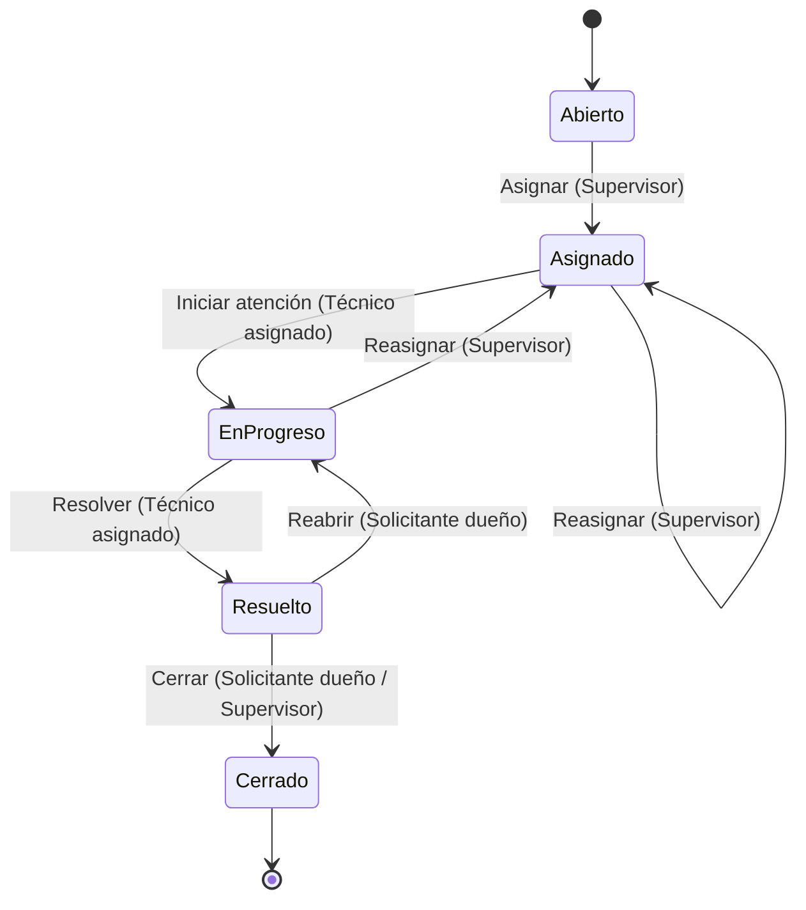

# 02 · Reglas de negocio

| Campo   | Valor                  |
| ------- | ---------------------- |
| Versión | 1.1                    |
| Fecha   | 28/10/2026             |
| Estado  | Borrador para revisión |

Cada regla está referenciada desde uno o más requisitos en [01-requisitos-funcionales.md](01-requisitos-funcionales.md) y debe estar cubierta por al menos una prueba. Su ubicación por capa sigue el criterio de [01-modelo-dominio.md §4](../technical/01-modelo-dominio.md#4-ubicación-de-las-reglas-de-negocio): invariantes y reglas de estado en **Domain**; formato de la entrada y reglas que requieren consultar la base de datos o conocer al actor en **Application**.

## Registro y datos del ticket

| ID    | Regla                                                                                                                                                                                                                     | RF    |
| ----- | ------------------------------------------------------------------------------------------------------------------------------------------------------------------------------------------------------------------------- | ----- |
| RN-01 | El título es obligatorio y tiene entre 5 y 150 caracteres. La descripción es obligatoria y tiene entre 10 y 2000 caracteres.                                                                                              | RF-01 |
| RN-02 | La categoría debe ser una de: `Hardware`, `Software`, `Red`, `Accesos`, `Otros`. La prioridad debe ser una de: `Critica`, `Alta`, `Media`, `Baja`.                                                                        | RF-01 |
| RN-03 | Todo ticket nuevo nace en estado `Abierto`, sin técnico asignado, con un código único y creciente con formato `HD-` + 6 dígitos (ej. `HD-000001`). Se aceptan huecos en la numeración. Solo el **solicitante** puede crear tickets. | RF-01 |
| RN-13 | La categoría de un ticket puede ser reclasificada por el **técnico asignado** o por un **supervisor**, siempre que el ticket no esté `Resuelto` ni `Cerrado`. La nueva categoría debe ser una de las permitidas en RN-02. | RF-01 |

## Visibilidad

| ID    | Regla                                                                                                                          | RF    |
| ----- | ------------------------------------------------------------------------------------------------------------------------------ | ----- |
| RN-04 | Un **solicitante** solo ve sus propios tickets. Un **técnico** solo ve los tickets asignados a él. Un **supervisor** ve todos. | RF-02 |
| RN-05 | Los listados se paginan con `page` desde 1 (por defecto 1) y `pageSize` entre 1 y 100 (por defecto 20), y se ordenan por fecha de creación descendente. | RF-02 |

## Asignación

| ID    | Regla                                                                                                                                                 | RF    |
| ----- | ----------------------------------------------------------------------------------------------------------------------------------------------------- | ----- |
| RN-06 | Solo un **supervisor** puede asignar o reasignar tickets, y solo a usuarios con rol **Técnico** que estén activos. No se puede reasignar al mismo técnico asignado. | RF-03 |
| RN-07 | Solo se puede asignar o reasignar un ticket en estado `Abierto`, `Asignado` o `En progreso`. Tras asignar o reasignar, el ticket queda en `Asignado`. | RF-03 |

## Ciclo de vida

### RN-08 · Transiciones permitidas

| Estado actual | Acción           | Estado nuevo | Quién puede ejecutarla         |
| ------------- | ---------------- | ------------ | ------------------------------ |
| Abierto       | Asignar          | Asignado     | Supervisor                     |
| Asignado      | Reasignar        | Asignado     | Supervisor                     |
| Asignado      | Iniciar atención | En progreso  | Técnico asignado               |
| En progreso   | Reasignar        | Asignado     | Supervisor                     |
| En progreso   | Resolver         | Resuelto     | Técnico asignado               |
| Resuelto      | Cerrar           | Cerrado      | Solicitante dueño o Supervisor |
| Resuelto      | Reabrir          | En progreso  | Solicitante dueño              |

Cualquier otra combinación de estado y acción es inválida (`409`). `Cerrado` es un estado final: no admite ninguna transición. Si quien ejecuta la acción no figura en la columna "Quién puede ejecutarla", se responde `403`.

"En progreso" es el texto de lectura; el valor del estado en la API es `EnProgreso` (ver [01-modelo-dominio.md §2](../technical/01-modelo-dominio.md#2-enumeraciones)).

| ID    | Regla                                                                                                                                                                        | RF    |
| ----- | ---------------------------------------------------------------------------------------------------------------------------------------------------------------------------- | ----- |
| RN-09 | Para **resolver** se exige un comentario de solución; para **reabrir** se exige un motivo. Al reabrir se borra la fecha de resolución y el ticket conserva el mismo técnico. El comentario de solución y el motivo de reapertura tienen como máximo 2000 caracteres. | RF-04 |

## SLA

### RN-10 · Tiempo de SLA por prioridad

| Prioridad | Horas de SLA |
| --------- | ------------ |
| Crítica   | 2            |
| Alta      | 4            |
| Media     | 8            |
| Baja      | 24           |

`FechaVencimiento = FechaCreacion + HorasSla(Prioridad)`, en horas calendario y en UTC (supuestos S-03 y S-04).

### RN-11 · Estado del SLA (valor calculado, no se almacena)

| Condición                                      | Estado del SLA |
| ---------------------------------------------- | -------------- |
| No resuelto y ahora ≤ vencimiento              | `EnTiempo`     |
| No resuelto y ahora > vencimiento              | `Vencido`      |
| Resuelto con fecha de resolución ≤ vencimiento | `Cumplido`     |
| Resuelto con fecha de resolución > vencimiento | `Incumplido`   |

"Resuelto" incluye los estados `Resuelto` y `Cerrado`.

| ID    | Regla                                                                                                                                                                              | RF    |
| ----- | ---------------------------------------------------------------------------------------------------------------------------------------------------------------------------------- | ----- |
| RN-12 | Solo el supervisor puede cambiar la prioridad, y solo si el ticket no está `Resuelto` ni `Cerrado`. Al cambiarla, el vencimiento se recalcula desde la fecha de creación original. | RF-05 |

## Matriz de permisos

Resume quién puede ejecutar cada operación según RN-03, RN-04, RN-06, RN-08, RN-12 y RN-13, y las decisiones 3, 7, 10 y 12 de [auditoria-documentacion.md §9](../../docs/auditoria-documentacion.md#9-decisiones-tomadas). Cualquier combinación marcada como `403` responde `403 Forbidden`.

| Operación                  | Solicitante                    | Técnico                                              | Supervisor |
| -------------------------- | ------------------------------ | ---------------------------------------------------- | ---------- |
| Crear ticket               | ✔                              | `403`                                                | `403`      |
| Consultar ticket por Id    | Solo los suyos (`403` si no)   | Solo los asignados a él (`403` si no)                | ✔          |
| Listar tickets             | Solo los suyos                 | Solo los asignados a él; filtrar por otro `tecnicoId` → `403` | ✔ |
| Reclasificar               | `403`                          | Solo el técnico asignado (`403` si no)               | ✔          |
| Asignar o reasignar        | `403`                          | `403`                                                | ✔          |
| Consultar técnicos activos | `403`                          | `403`                                                | ✔          |
| Iniciar atención           | `403`                          | Solo el técnico asignado (`403` si no)               | `403`      |
| Resolver                   | `403`                          | Solo el técnico asignado (`403` si no)               | `403`      |
| Cerrar                     | Solo el solicitante dueño (`403` si no) | `403`                                       | ✔          |
| Reabrir                    | Solo el solicitante dueño (`403` si no) | `403`                                       | `403`      |
| Cambiar prioridad          | `403`                          | `403`                                                | ✔          |
| Reporte de vencidos        | `403`                          | `403`                                                | ✔          |

## Matriz regla → requisito

| Regla | RF-01 | RF-02 | RF-03 | RF-04 | RF-05 | RF-06 |
| ----- | ----- | ----- | ----- | ----- | ----- | ----- |
| RN-01 | ✔     |       |       |       |       |       |
| RN-02 | ✔     |       |       |       |       |       |
| RN-03 | ✔     |       |       |       |       |       |
| RN-04 |       | ✔     |       |       |       |       |
| RN-05 |       | ✔     |       |       |       |       |
| RN-06 |       |       | ✔     |       |       |       |
| RN-07 |       |       | ✔     |       |       |       |
| RN-08 |       |       | ✔     | ✔     |       |       |
| RN-09 |       |       |       | ✔     |       |       |
| RN-10 | ✔     |       |       |       | ✔     |       |
| RN-11 |       | ✔     |       |       | ✔     | ✔     |
| RN-12 |       |       |       |       | ✔     |       |
| RN-13 | ✔     |       |       |       |       |       |
