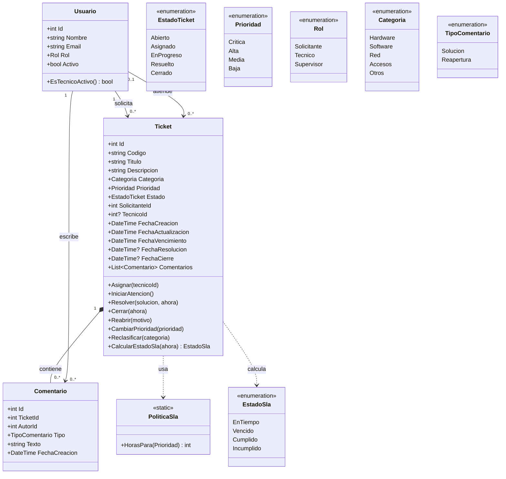
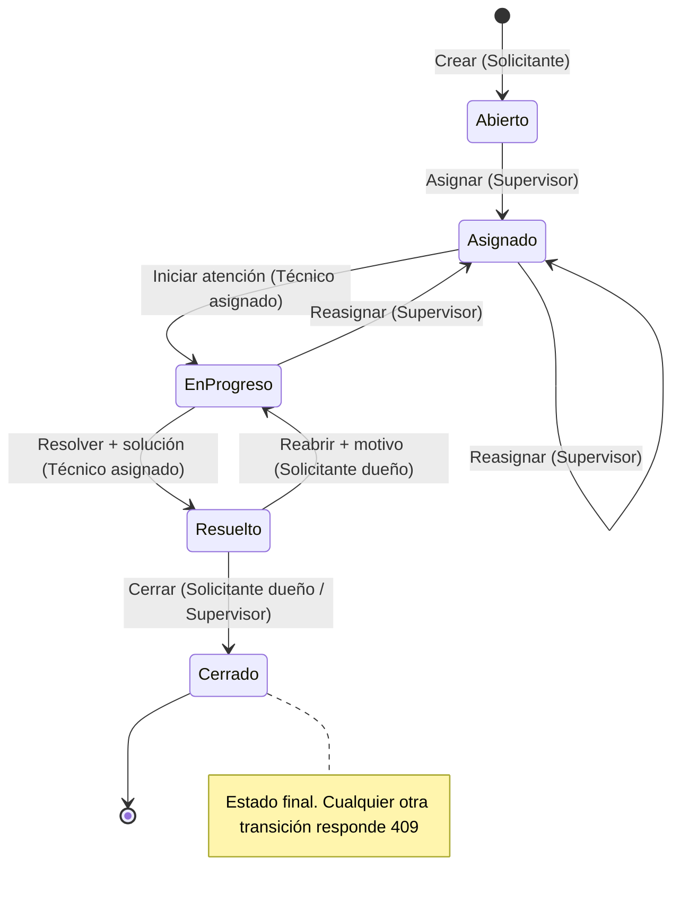

# 01 · Modelo de dominio

| Campo   | Valor                  |
| ------- | ---------------------- |
| Versión | 1.5                    |
| Fecha   | 28/10/2026             |
| Estado  | Aprobado               |

Deriva de [specs/functional/](../functional/) ([00 visión](../functional/00-vision.md), [01 RF/CA](../functional/01-requisitos-funcionales.md), [02 RN](../functional/02-reglas-negocio.md), [03 RNF](../functional/03-requisitos-no-funcionales.md)). Todas las fechas son `DateTime` en **UTC** (S-04) y los Id son `int` de identidad.

---

## 1. Entidades

### Usuario

Se carga como dato semilla (S-01); no hay endpoint de registro.

| Atributo | Tipo   | Reglas                                    |
| -------- | ------ | ----------------------------------------- |
| Id       | int    | PK                                        |
| Nombre   | string | Obligatorio, máx. 100                     |
| Email    | string | Obligatorio, único (índice único), máx. 150 |
| Rol      | Rol    | Obligatorio                               |
| Activo   | bool   | Solo los técnicos activos se asignan (RN-06) |

**Comportamiento:** `EsTecnicoActivo()` → `Rol == Tecnico && Activo`.

### Ticket (raíz de agregado)

| Atributo         | Tipo             | Reglas                                                 |
| ---------------- | ---------------- | ------------------------------------------------------ |
| Id               | int              | PK                                                     |
| Codigo           | string(9)        | `HD-` + 6 dígitos, único y creciente desde `HD-000001`; se aceptan huecos; límite `HD-999999` (RN-03, índice único) |
| Titulo           | string           | 5–150 caracteres (RN-01)                               |
| Descripcion      | string           | 10–2000 caracteres (RN-01)                             |
| Categoria        | Categoria        | RN-02; reclasificable (RN-13)                          |
| Prioridad        | Prioridad        | RN-02; modificable por el supervisor (RN-12)           |
| Estado           | EstadoTicket     | Nace `Abierto` (RN-03); cambia según RN-08             |
| SolicitanteId    | int              | FK Usuario, obligatorio                                |
| TecnicoId        | int?             | FK Usuario, nulo hasta asignar                         |
| FechaCreacion    | DateTime         | UTC, inmutable                                         |
| FechaActualizacion | DateTime       | UTC, fecha de la última modificación del ticket; al crear, es igual a `FechaCreacion`. El historial de cambios queda fuera del MVP |
| FechaVencimiento | DateTime         | UTC, `FechaCreacion + HorasSla(Prioridad)` (RN-10)     |
| FechaResolucion  | DateTime?        | Se fija al resolver y se borra al reabrir (RN-09)      |
| FechaCierre      | DateTime?        | Se fija al cerrar                                      |
| Comentarios      | List<Comentario> | Composición                                            |

Los límites de RN-01 se exponen como constantes públicas de `Ticket` (`TituloLongitudMinima`, `TituloLongitudMaxima`, `DescripcionLongitudMinima`, `DescripcionLongitudMaxima`), que reutilizan los validadores de Application ([ADR-003](adr/ADR-003-fluentvalidation.md)).

**Comportamiento (Domain):**

| Método                     | Efecto                                                                    | RN           |
| -------------------------- | ------------------------------------------------------------------------- | ------------ |
| `Crear(...)`               | Valida las longitudes de RN-01 (`InvarianteVioladaException` si se violan), estado `Abierto`, sin técnico, calcula vencimiento | RN-01, RN-03, RN-10 |
| `Asignar(tecnicoId)`       | Asigna o reasigna; queda `Asignado`                                       | RN-07, RN-08 |
| `IniciarAtencion()`        | `Asignado` → `EnProgreso`                                                 | RN-08        |
| `Resolver(solucion, ahora)`| Valida la solución (no vacía, ≤ `Comentario.TextoLongitudMaxima`; `InvarianteVioladaException`); `EnProgreso` → `Resuelto`; fija FechaResolucion; agrega comentario `Solucion` | RN-08, RN-09 |
| `Cerrar(ahora)`            | `Resuelto` → `Cerrado`; fija FechaCierre                                  | RN-08        |
| `Reabrir(motivo)`          | Valida el motivo (no vacío, ≤ `Comentario.TextoLongitudMaxima`; `InvarianteVioladaException`); `Resuelto` → `EnProgreso`; borra FechaResolucion; conserva técnico; agrega comentario `Reapertura` | RN-08, RN-09 |
| `CambiarPrioridad(nueva)`  | Recalcula FechaVencimiento desde FechaCreacion                            | RN-10, RN-12 |
| `Reclasificar(categoria)`  | Cambia la categoría                                                       | RN-13        |
| `CalcularEstadoSla(ahora)` | Devuelve `EstadoSla`; **no se persiste**                                  | RN-11        |

`Reclasificar` y `CambiarPrioridad` no cambian el estado. Comparten la guarda `EstaAbiertoParaCambios()` (el ticket no está `Resuelto` ni `Cerrado`) y quedan fuera de la tabla de transiciones de RN-08.

### Comentario

| Atributo      | Tipo           | Reglas                       |
| ------------- | -------------- | ---------------------------- |
| Id            | int            | PK                           |
| TicketId      | int            | FK Ticket                    |
| AutorId       | int            | FK Usuario                   |
| Tipo          | TipoComentario | `Solucion` o `Reapertura`    |
| Texto         | string         | Obligatorio, máx. 2000 (constante pública `Comentario.TextoLongitudMaxima`) |
| FechaCreacion | DateTime       | UTC                          |

Resolver genera un comentario `Solucion` y reabrir uno `Reapertura` (RN-09). Así queda la trazabilidad sin columnas extra en Ticket. No hay comentarios generales en el MVP.

## 2. Enumeraciones

Se persisten como texto, coherente con RNF-09 (enums como texto en OpenAPI).

| Enum           | Valores                                          | Origen      |
| -------------- | ------------------------------------------------ | ----------- |
| EstadoTicket   | Abierto, Asignado, EnProgreso, Resuelto, Cerrado | RN-08       |
| Prioridad      | Critica, Alta, Media, Baja                       | RN-02       |
| Rol            | Solicitante, Tecnico, Supervisor                 | 00-vision   |
| EstadoSla      | EnTiempo, Vencido, Cumplido, Incumplido          | RN-11 (calculado) |
| Categoria      | Hardware, Software, Red, Accesos, Otros          | RN-02       |
| TipoComentario | Solucion, Reapertura                             | RN-09       |

## 3. Relaciones y cardinalidades

| Relación                          | Cardinalidad                                |
| --------------------------------- | ------------------------------------------- |
| Usuario (Solicitante) crea Ticket | 1 — 0..\*                                   |
| Usuario (Técnico) atiende Ticket  | 0..1 — 0..\*                                |
| Ticket contiene Comentario        | 1 — 0..\* (composición, borrado en cascada) |
| Usuario escribe Comentario        | 1 — 0..\*                                   |

El MVP no elimina tickets ([00-vision.md §4](../functional/00-vision.md#4-alcance)); el borrado en cascada solo describe la composición.

## 4. Ubicación de las reglas de negocio

Criterio (ver [ADR-003](adr/ADR-003-fluentvalidation.md)): el formato de la entrada se valida en **Application** con FluentValidation (`400` con detalle). **Domain** protege las invariantes de RN-01 y RN-09 con las mismas constantes (`InvarianteVioladaException`; `500` si llega a la API) y las reglas de estado (`TransicionInvalidaException`; `409`). Lo que requiere consultar la base de datos o conocer al actor (rol, dueño) va en **Application** (`403` o `400`).

**Excepciones de dominio** (decisión 40, Enmienda 4 de [ADR-004](adr/ADR-004-problemdetails-errores.md#enmienda-4--28102026)): exponen una propiedad `Codigo` con un valor del catálogo de `codigo`. `TransicionInvalidaException` se lanza con el `Codigo` que corresponde al caso, y la Api lo copia al campo `codigo` de Problem Details:

| Caso | Excepción | `Codigo` | HTTP |
| ---- | --------- | -------- | ---- |
| Transición no permitida por RN-08, incluido asignar un ticket `Resuelto` o `Cerrado` (RN-07) | `TransicionInvalidaException` | `TRANSICION_INVALIDA` | `409` |
| Reclasificar (RN-13) o cambiar la prioridad (RN-12) de un ticket `Resuelto` o `Cerrado` | `TransicionInvalidaException` | `TICKET_NO_MODIFICABLE` | `409` |
| Invariante violada (RN-01, RN-09) | `InvarianteVioladaException` | Se ignora: en los `500` la Api responde siempre `ERROR_INTERNO`, sin detalles internos, y registra el detalle de la excepción en el log (decisión 41) | `500` |

| RN    | Capa                 | Responsable                                                                                                                                    |
| ----- | -------------------- | ---------------------------------------------------------------------------------------------------------------------------------------------- |
| RN-01 | Domain + Application | `Ticket.Crear` (invariante con constantes públicas; `InvarianteVioladaException`) · `CrearTicketValidator` (mismas constantes; `400` con detalle, RNF-05) |
| RN-02 | Domain + Application | Enums `Categoria` y `Prioridad` · `CrearTicketValidator`                                                                                       |
| RN-03 | Domain + Application | `Ticket.Crear` (`Abierto`, sin técnico) · `IGeneradorCodigoTicket` (único y creciente; en Infrastructure con una SEQUENCE de SQL Server)            |
| RN-04 | Application          | `ListarTicketsHandler` / `ObtenerTicketHandler` (filtro por rol; `403` si el ticket no le corresponde)                                        |
| RN-05 | Application          | `ListarTicketsValidator` (`page` ≥ 1, por defecto 1; `pageSize` 1–100, por defecto 20; filtros válidos). Las constantes de paginación viven en Application · consulta paginada ordenada por FechaCreacion descendente                             |
| RN-06 | Application + Domain | `AsignarTicketHandler` (actor supervisor, si no `403`; técnico existente y `Usuario.EsTecnicoActivo()`, si no `400`; reasignar al mismo técnico, `400`)                          |
| RN-07 | Domain               | `Ticket.Asignar` (solo desde `Abierto`, `Asignado` o `EnProgreso`; queda `Asignado`; si no, `TransicionInvalidaException` con `TRANSICION_INVALIDA` → `409`) |
| RN-08 | Domain + Application | `Ticket` (métodos de transición; una transición inválida lanza `TransicionInvalidaException` con `TRANSICION_INVALIDA` → `409`) · handlers verifican quién puede (`403`) |
| RN-09 | Domain + Application | `Ticket.Resolver` / `Ticket.Reabrir` (invariante: texto no vacío y ≤ `Comentario.TextoLongitudMaxima`; `InvarianteVioladaException`) · `ResolverTicketValidator` / `ReabrirTicketValidator` (mismas constantes; `400` con detalle, CA-04.3) · `Resolver` fija FechaResolucion; `Reabrir` la borra y conserva el técnico |
| RN-10 | Domain               | `PoliticaSla.HorasPara(Prioridad)` · `Ticket.Crear` calcula FechaVencimiento                                                                   |
| RN-11 | Domain               | `Ticket.CalcularEstadoSla(ahora)`; `ahora` se obtiene de `TimeProvider` (RNF-08)                                                              |
| RN-12 | Domain + Application | `Ticket.CambiarPrioridad` (`TransicionInvalidaException` con `TICKET_NO_MODIFICABLE` → `409` si `Resuelto`/`Cerrado`; recalcula desde FechaCreacion) · `CambiarPrioridadHandler` (solo supervisor, si no `403`) |
| RN-13 | Domain + Application | `Ticket.Reclasificar` (`TransicionInvalidaException` con `TICKET_NO_MODIFICABLE` → `409` si `Resuelto`/`Cerrado`, CA-01.7) · `ReclasificarTicketValidator` (categoría válida, si no `400`) · `ReclasificarTicketHandler` (técnico asignado o supervisor, si no `403`, CA-01.8) |

## 5. Diagrama de clases

## 6. Diagrama de estados del ticket (RN-08)

Reclasificar (RN-13) y cambiar la prioridad (RN-12) no aparecen en el diagrama porque no cambian el estado; solo se permiten en `Abierto`, `Asignado` y `EnProgreso`.

## 7. Contradicciones y vacíos detectados

| #   | Hallazgo                                                                                                                                         | Dónde                   | Propuesta                                  | Decisión                                                                      |
| --- | ------------------------------------------------------------------------------------------------------------------------------------------------ | ----------------------- | ------------------------------------------ | ----------------------------------------------------------------------------- |
| 1   | Asignar a un técnico **inactivo** o **inexistente**: RN-06 lo prohíbe, pero ningún CA dice qué código responder.                                 | RN-06 vs CA-03.3        | `400` y ampliar CA-03.3.                   | ✅ Aceptado: técnico inactivo o inexistente → `400`; ampliar CA-03.3.          |
| 2   | La visión dice que el técnico "registra comentarios", pero ningún RF tiene endpoint para comentarios generales.                                  | 00-vision §3 vs RF-04   | Tipo `General` sin endpoint, o añadir CA.  | ✏️ Se elimina el tipo `General`; la visión deja de decir "registrar comentarios". |
| 3   | RN-12: solo el supervisor cambia la prioridad, pero RF-05 no tiene CA para el `403`.                                                             | RN-12 vs RF-05          | Añadir CA-05.6.                            | ✅ Aceptado: agregar CA-05.6.                                                  |
| 4   | RN-04 limita al técnico a sus tickets, pero CA-02.6 solo define `403` para el solicitante.                                                       | RN-04 vs CA-02.6        | Extender CA-02.6.                          | ✅ Aceptado: CA-02.6 también aplica al técnico.                                |
| 5   | Al reabrir, el vencimiento sigue siendo el original: un ticket reabierto suele quedar `Vencido` al instante.                                     | RN-09 + RN-11           | Confirmar.                                 | ✅ Confirmado: reabrir conserva el vencimiento original.                       |
| 6   | Grafía: RN-02 usa `Critica` y RN-10 "Crítica".                                                                                                   | RN-02 vs RN-10          | Enum `Critica`.                            | ✅ Aceptado: enum `Critica` sin tilde.                                         |
| 7   | RN-01 define la longitud de la descripción, pero CA-01.3 solo cubre el título.                                                                   | RN-01 vs CA-01.3        | Añadir CA.                                 | ✅ Aceptado: CA-01.3 se extiende a la descripción.                             |
| 8   | Sin longitud para el comentario o motivo, ni comportamiento para `page` < 1.                                                                     | RN-09, CA-02.4          | Texto ≤ 2000; definir `page`.              | ✅ Aceptado: texto de comentario ≤ 2000; `page` < 1 → `400`.                   |
| 9   | Tickets asignados a un técnico que se desactiva.                                                                                                 | RN-06                   | Fuera del MVP.                             | ✅ Aceptado: fuera del MVP; anotarlo en la visión.                             |
| 10  | RN-13 exige una categoría válida, pero no hay CA para el `400` al reclasificar.                                                                  | RN-13 vs CA-01.6–01.8   | Añadir CA-01.9.                            | ✅ Aceptado: agregar CA-01.9.                                                  |
| 11  | En un ticket `Abierto` solo el supervisor puede reclasificar, porque aún no hay técnico asignado.                                                | RN-13                   | Confirmar.                                 | ✅ Confirmado.                                                                 |
| 12  | `03-requisitos-no-funcionales.md` desactualizado: RNF-10 dice "31 CA y 12 RN"; RNF-01 no cita CA-01.8 y RNF-04 no cita CA-01.7.                  | 03 vs 01/02             | Actualizar 03.                             | ✅ Aceptado: actualizar `03-requisitos-no-funcionales.md`.                     |
| 13  | La visión da al técnico permiso para reclasificar cualquier ticket; RN-13 lo limita al asignado.                                                 | 00-vision §3 vs RN-13   | Prevalece RN-13.                           | ✅ Aceptado: la visión dice "reclasificar sus tickets asignados".              |

## 8. Datos semilla

Las migraciones de EF Core son la fuente del modelo físico (tablas, columnas, índices y SEQUENCE); este documento no lo duplica ([ADR-002](adr/ADR-002-sqlserver-efcore.md)).

Usuarios cargados como datos semilla (S-01): 5 solicitantes, 4 técnicos (uno inactivo) y 1 supervisor. Nombres y correos ficticios, con el dominio reservado para ejemplos `example.com`.

| #  | Nombre            | Email                        | Rol         | Activo |
| -- | ----------------- | ---------------------------- | ----------- | ------ |
| 1  | Ana Solicitante   | ana.solicitante@example.com  | Solicitante | Sí     |
| 2  | Bruno Solicitante | bruno.solicitante@example.com | Solicitante | Sí    |
| 3  | Carla Solicitante | carla.solicitante@example.com | Solicitante | Sí    |
| 4  | Diego Solicitante | diego.solicitante@example.com | Solicitante | Sí    |
| 5  | Elena Solicitante | elena.solicitante@example.com | Solicitante | Sí    |
| 6  | Fabián Técnico    | fabian.tecnico@example.com   | Tecnico     | Sí     |
| 7  | Gabriela Técnico  | gabriela.tecnico@example.com | Tecnico     | Sí     |
| 8  | Hugo Técnico      | hugo.tecnico@example.com     | Tecnico     | Sí     |
| 9  | Irene Técnico     | irene.tecnico@example.com    | Tecnico     | **No** |
| 10 | Jorge Supervisor  | jorge.supervisor@example.com | Supervisor  | Sí     |

La columna "#" solo numera las filas; los Id reales los fija la migración.
