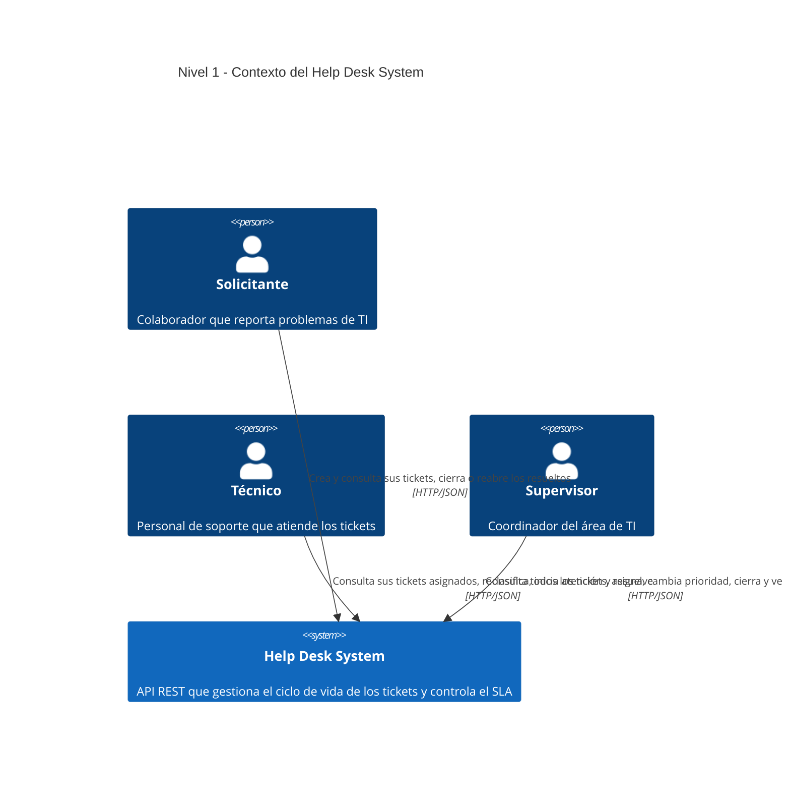
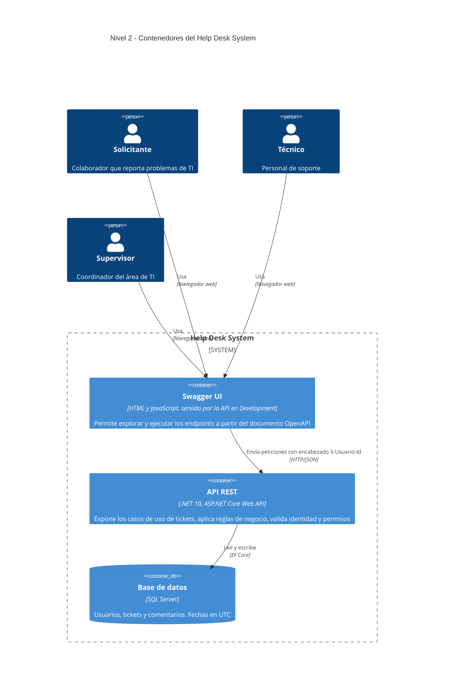
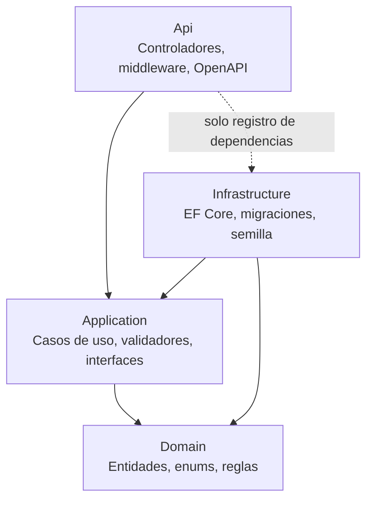

# 02 · Arquitectura (modelo C4)

| Campo   | Valor                  |
| ------- | ---------------------- |
| Versión | 1.0                    |
| Fecha   | 27/10/2026             |
| Estado  | Borrador para revisión |

Describe la arquitectura del MVP en los niveles 1 (Contexto) y 2 (Contenedores) del modelo C4, y la organización interna de la API en Clean Architecture. Deriva de `specs/functional/00-vision.md`, `specs/functional/03-requisitos-no-funcionales.md` y `specs/technical/01-modelo-dominio.md`.

---

## 1. Nivel 1 · Contexto

Muestra quién usa el sistema y con qué se relaciona. Los tres roles interactúan con el Help Desk System a través de Swagger UI (no hay frontend). **No hay sistemas externos en el MVP**: los usuarios son datos semilla (S-01), la identidad llega en el encabezado `X-Usuario-Id` (S-02) y no se envían correos ni notificaciones.

## 2. Nivel 2 · Contenedores

Muestra las piezas desplegables del sistema y cómo se comunican. Cada petición lleva el encabezado `X-Usuario-Id`; la API valida la identidad (`401`) y el permiso (`403`) antes de ejecutar el caso de uso (RNF-01). La API accede a SQL Server solo mediante EF Core con consultas parametrizadas (RNF-02).

| Contenedor   | Tecnología                         | Responsabilidad                                                                                  | Comunicación                                   |
| ------------ | ---------------------------------- | ------------------------------------------------------------------------------------------------ | ---------------------------------------------- |
| Swagger UI   | HTML/JavaScript servido por la API | Documentación interactiva y cliente de pruebas (RNF-09)                                          | HTTP/JSON hacia la API, con `X-Usuario-Id`     |
| API REST     | .NET 10 · ASP.NET Core Web API     | Endpoints, identidad por encabezado, reglas de negocio, errores en Problem Details (RNF-03)     | Recibe HTTP/JSON; accede a la BD con EF Core   |
| Base de datos| SQL Server                         | Persistencia de `Usuario`, `Ticket` y `Comentario`; índices de RNF-06; SEQUENCE para el código   | Solo la API se conecta                         |

## 3. Clean Architecture (organización interna de la API)

La API se divide en cuatro proyectos. Las dependencias apuntan siempre hacia el centro (Domain), conforme a RNF-07.

| Capa               | Contiene                                                                                                                                                                                                                                  | Puede referenciar                       |
| ------------------ | ----------------------------------------------------------------------------------------------------------------------------------------------------------------------------------------------------------------------------------------- | --------------------------------------- |
| **Domain**         | Entidades (`Ticket`, `Usuario`, `Comentario`), enumeraciones, `PoliticaSla`, invariantes y transiciones (RN-01, RN-03, RN-07 a RN-13), excepciones de dominio (`TransicionInvalidaException`). Sin EF Core ni ASP.NET Core.                | Ninguna                                 |
| **Application**    | Casos de uso (handlers), validadores FluentValidation, DTOs, reglas que dependen de datos o del actor (RN-04, RN-05, RN-06), interfaces de persistencia y de `IGeneradorCodigoTicket`. Usa `TimeProvider` para la hora actual (RNF-08). | Domain                                  |
| **Infrastructure** | `DbContext` de EF Core, configuraciones de entidades, migraciones, datos semilla de usuarios, implementación de repositorios y del generador de código con SEQUENCE de SQL Server.                                                         | Application, Domain                     |
| **Api**            | Controladores, lectura del encabezado `X-Usuario-Id` (`401`), traducción de excepciones a Problem Details (`400`, `403`, `404`, `409`, `500`), configuración de OpenAPI y Swagger UI, registro de dependencias (`Program.cs`).          | Application, Infrastructure (solo para registrar dependencias) |

**Regla de dependencias:**

- Domain no depende de ningún otro proyecto ni de paquetes de infraestructura.
- Application define interfaces que Infrastructure implementa (inversión de dependencias).
- Los controladores de Api solo invocan casos de uso de Application; no contienen reglas de negocio ni usan el `DbContext` directamente.
- Las pruebas xUnit referencian la capa que prueban: unitarias sobre Domain y Application; de integración sobre Api.

## 4. Fuera de alcance

No forman parte de esta arquitectura: Docker, colas de mensajes, caché, correo, autenticación JWT ni servicios externos (ver `00-vision.md`, sección 4).
